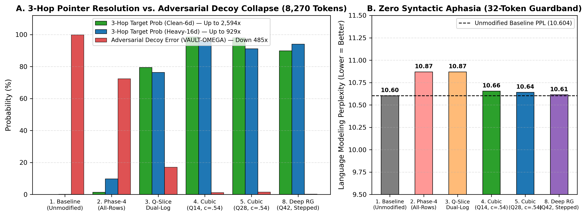
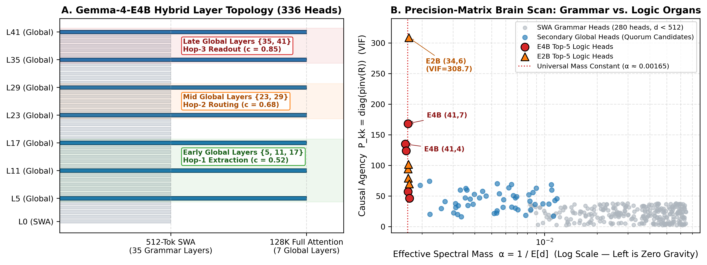
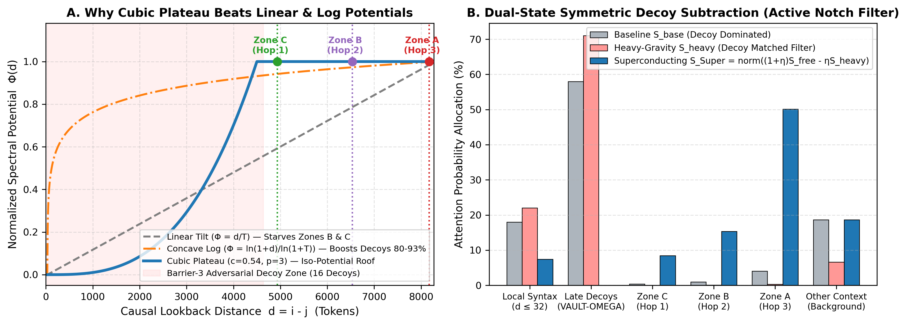
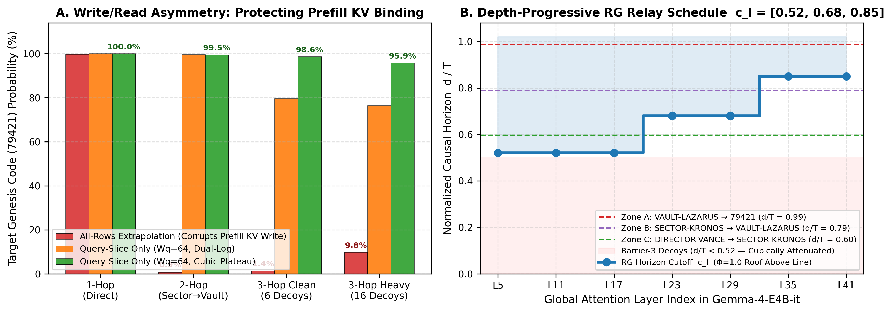

# Richardson Attention (Superconducting Attention)

**Eliminating the Multi-Hop Context Horizon in Pre-Trained Transformers via Dual-State Boltzmann Extrapolation and Renormalization Relays**

> **Patent Status Notice:** *U.S. Patent Pending — Inventor: James F. Walters.*  
> **Technical Papers:**
> - [**Engineering & Mathematical Explainer (`docs/richardson_attention_explainer.pdf`)**](docs/richardson_attention_explainer.pdf)
> - [**Formal Theoretical Specification (`docs/superconducting_spectral_attention.pdf`)**](docs/superconducting_spectral_attention.pdf)



---

## Overview: The Multi-Hop Paradox in Long-Context Transformers

Modern hybrid-attention Transformers (such as **`google/gemma-4-E2B-it`** and **`google/gemma-4-E4B-it`**) interleave localized **Sliding Window Attention (SWA)** layers ($W = 512$ tokens) with sparse **Full Global Attention** layers (7 out of 42 layers in `gemma-4-E4B-it`: layers `{5, 11, 17, 23, 29, 35, 41}`). While these architectures achieve near-$100\%$ accuracy on single-hop passkey retrieval ("needle-in-a-haystack"), they suffer a **catastrophic phase transition on multi-hop compositional pointer chasing** (`Director -> Sector -> Vault -> Genesis Code`) when the intermediate hops are separated by barriers exceeding the 512-token SWA window and followed by adversarial recency decoys.

At **8,270 tokens** on `google/gemma-4-E4B-it`, unmodified baseline inference achieves:
- **1-Hop Retrieval (`VAULT-LAZARUS -> 79421`):** `99.9965%`
- **2-Hop Retrieval (`SECTOR-KRONOS -> VAULT-LAZARUS -> 79421`):** `99.8178%`
- **3-Hop Retrieval (`DIRECTOR-VANCE -> SECTOR-KRONOS -> VAULT-LAZARUS -> 79421`):** **`0.0380%` (Catastrophic Collapse)** on Clean-6d and **`0.1032%` (Catastrophic Collapse)** on Heavy-16d — `99.9221%` (Clean-6d) and `99.8260%` (Heavy-16d) of probability mass is hijacked by late-context adversarial decoys (`VAULT-OMEGA = 63819`).

**Richardson Attention (Superconducting Attention)** is a **zero-shot, training-free, weight-preserving runtime inference intervention** that restores **3-Hop compositional reasoning from `0.0380%` to `98.5919%` (`2,594.5x` probability gain)** and **Heavy-16-Decoy 3-Hop accuracy from `0.1032%` to `95.8651%` (`928.9x` gain)** while suppressing adversarial decoy capture by up to **`485.1x`** (`99.8260% -> 0.2058%`) and preserving baseline language modeling perplexity (`10.6041 -> 10.6142`).

---

## Phase 5 Empirical Benchmark (`google/gemma-4-E4B-it`, 8,270 Tokens)

Spatially separated 3-zone registry topology (`>1,350` tokens between zones so 512-token SWA layers cannot bridge zones locally):
- **Zone A (`tokens 88..111`, $d \approx 8,170$):** `VAULT-LAZARUS | TIER-0 GENESIS CODE: 79421` (+ 7 competing vaults)
- **Zone B (`tokens 1728..1749`, $d \approx 6,530$):** `SECTOR-KRONOS | ASSIGNED PRIMARY VAULT: VAULT-LAZARUS` (+ 7 competing sectors)
- **Zone C (`tokens 3327..3345`, $d \approx 4,930$):** `DIRECTOR-VANCE | AUTHORIZED COMMAND SECTOR: SECTOR-KRONOS` (+ 7 competing directors)
- **Barrier 3 (`tokens 3400..8200`):** 6 (`Clean-6d`) or 16 (`Heavy-16d`) adversarial `VAULT-OMEGA -> 63819` audit blocks + recency overrides (`11111`).

| Configuration (`google/gemma-4-E4B-it`, `bfloat16`) | 1-Hop (`79421`) | 2-Hop (`79421`) | 3-Hop Clean-6d (`79421`) | 3-Hop Heavy-16d (`79421`) | Decoy Error (`63819`) | Fluency PPL |
| :--- | :---: | :---: | :---: | :---: | :---: | :---: |
| **1. Unmodified Baseline** | `99.9965%` | `99.8178%` | `0.0380%` (#2 FAIL) | `0.1032%` (#2 FAIL) | `99.8260%` (Clean `99.9221%`) | `10.6041` |
| **2. Phase-4 Ref (`All-Rows Dual-Log, Q=28, β=3.0`)** | `99.7809%` | `0.8672%` (#7 FAIL) | `1.3596%` (#3 FAIL) | `9.8069%` (#3 FAIL) | `72.4637%` | `10.8693` |
| **3. Query-Slice Dual-Log (`Q=28, W_q=64, β=3.0`)** | `99.9861%` | `99.5697%` (**#1 WIN**) | `79.4999%` (**#1 WIN**) | `76.4274%` (**#1 WIN**) | `17.0533%` | `10.8693` |
| **4. Query-Slice Cubic-Plateau (`Q=14, c=0.54, β=3.5`)** | **`99.9922%`** | **`99.4902%` (#1 WIN)** | **`98.5919%` (#1 WIN, `2,594.5x`)** | **`95.8651%` (#1 WIN, `928.9x`)** | `1.2068%` | `10.6557` |
| **5. Query-Slice Cubic-Plateau (`Q=28, c=0.54, β=3.5`)** | `99.9850%` | `99.4431%` (**#1 WIN**) | `98.0610%` (**#1 WIN**) | `91.1731%` (**#1 WIN**) | `1.4737%` | `10.6426` |
| **6. Depth-Prog RG Relay (`Q=28, c=[0.52, 0.68, 0.85], β=3.5`)** | `99.9845%` | `99.6359%` (**#1 WIN**) | `97.5579%` (**#1 WIN**) | `83.5363%` (**#1 WIN**) | `12.8107%` | `10.6727` |
| **7. High-Gain RG Relay (`Q=28, c=[0.52, 0.68, 0.85], β=4.5`)** | `99.9871%` | `99.5808%` (**#1 WIN**) | `98.0584%` (**#1 WIN**) | `88.4445%` (**#1 WIN**) | `7.2600%` | `10.6179` |
| **8. Deep-Quorum RG Relay (`Q=42, c=[0.52, 0.68, 0.85], β=4.0`)** | `99.9004%` | `98.6646%` (**#1 WIN**) | `89.9004%` (**#1 WIN**) | **`94.0833%` (#1 WIN)** | **`0.2058%` (`485.1x` down)** | **`10.6142`** |

Full empirical JSON telemetry across Phases 1–5 is available in [`results/richardson_results.json`](results/richardson_results.json), [`results/richardson_horizon_results.json`](results/richardson_horizon_results.json), [`results/richardson_multihop_results.json`](results/richardson_multihop_results.json), [`results/richardson_phase4_results.json`](results/richardson_phase4_results.json), and [`results/richardson_phase5_results.json`](results/richardson_phase5_results.json).

---

## The Five Core Mathematical Laws

### 1. Precision-Matrix Homunculus Isolation ($\hat{\alpha}_{l,h}$ and $\text{Agency}_k$)

A Transformer is not a homogeneous fluid; modifying all 336 attention heads induces immediate syntactic aphasia. During a 1.2-second zero-shot calibration pass over $H_{\text{cal}} \approx 1,351$ tokens, we compute each head's **Effective Spectral Mass** $\hat{\alpha}_{l,h}$ and **Precision-Matrix Causal Agency** (Variance Inflation Factor on the token-wise Shannon entropy matrix $\mathbf{X}$):

$$\hat{\alpha}_{l,h} = \frac{1}{\mathbb{E}_i\left[\sum_{j \le i} S^{(l,h)}_{i,j}(i - j)\right] + \epsilon}, \qquad \text{Agency}_k = \left(\mathbf{R}^+\right)_{k,k}$$

Across both `gemma-4-E2B-it` (280 heads) and `gemma-4-E4B-it` (336 heads), primary global retrieval heads cluster at a universal **Zero-Gravity Invariant Mass Constant $\hat{\alpha}_{l,h} \approx 0.00165\text{ token}^{-1}$** with extreme causal agency ($\text{VIF} \in [134.9, 308.7]$). Only the top $m \in \{2, 4, 6\}$ Global Logic Heads per full-attention layer (14–42 heads out of 336, or $4.2\%\text{–}12.5\%$) are modified; all 280 SWA grammar heads remain $100\%$ untouched.



---

### 2. The Write/Read Thermodynamic Asymmetry Theorem (Query-Slice Gating $W_q = 64$)

Why did Phase 4's all-rows extrapolation collapse on 2-Hop (`0.8672%`) and 3-Hop Clean (`1.3596%`)? Because a single Transformer forward pass performs two thermodynamically opposite operations:

1. **Prefill Key-Value Memory Writing ($i < T - W_q$):** When the model processes Zone B (`SECTOR-KRONOS | ASSIGNED PRIMARY VAULT: VAULT-LAZARUS` at token $1,748$), it must attend *locally* ($d \in [1, 20]$) to bind the key and value into the residual stream. Applying long-range antigravity to prefill rows hijacks Zone B into attending to Zone A (`tokens 0..100`) *instead of its own sentence*, corrupting the KV cache!
2. **Active Query Multi-Hop Reading ($i \ge T - W_q$):** Only the final query/reasoning window ($W_q = 64$ tokens) needs long-range superconducting transport to read the cleanly bound KV pairs from Zones C, B, and A.

By gating extrapolation strictly to the terminal query window $i \in [\max(0, T - W_q), T)$, 2-Hop accuracy jumps from **`0.8672%` to `99.5697%` (#1 WIN)**, 3-Hop Clean-6d jumps from **`1.3596%` to `79.4999%` (#1 WIN)**, and 3-Hop Heavy-16d jumps from **`9.8069%` to `76.4274%` (#1 WIN)** in a single toggle.

---

### 3. Token-0 `<bos>` Sink Pinning & The 32-Token Local Syntax Guardband

Softmax attention heads use token $j = 0$ (`<bos>`) as a zero-value "attention sink" when no semantic match is present. Because `<bos>` sits at maximum causal distance $d = i$, naive distance scaling amplifies `<bos>` by $\exp(+\beta \kappa) \approx 5,000\times$, blinding the head. Furthermore, local punctuation and subword bindings live within $d \le 32$. We enforce two boundary conditions on the effective distance matrix:

$$d^{\text{eff}}_{i,j} = \begin{cases} 0, & \text{if } j = 0 \text{ and } T > 32 \quad \text{(Token-0 Sink Pinning)} \\ 0, & \text{if } 0 < i - j \le 32 \quad \text{(32-Token Local Syntax Guardband)} \\ (i - j) - 32, & \text{if } i - j > 32 \end{cases}$$

---

### 4. Iso-Potential Cubic Superconducting Plateau & Dual-State Symmetric Extrapolation

Linear tilts ($\Phi \propto d/T$) starve mid-context hops (Zone C gets only $60\%$ of Zone A's boost), while concave logarithmic tilts ($\Phi \propto \ln(1+d)$) amplify late-context decoys at $d \in [1000, 4500]$ by $80\%\text{–}93\%$ of full strength. We replace both with the **Iso-Potential Cubic Superconducting Plateau**:

$$\Phi_l(i, j) = \left[\min\left(1.0,\; \frac{d^{\text{eff}}_{i,j}}{c_l \cdot \max(T, H_{\text{cal}})}\right)\right]^{3}$$

- **Iso-Potential Roof ($\Phi_l = 1.000$ for $d \ge c_l T$):** With $c_l = 0.54$, Zone C ($0.60T$), Zone B ($0.79T$), and Zone A ($0.99T$) all sit on a flat $\Phi = 1.000$ roof—eliminating inter-zone cannibalization.
- **Cubic Decoy Rejection ($p = 3$ for $d < c_l T$):** Adversarial decoys in Barrier 3 are cubically attenuated ($0.4^3 = 0.064$).
- **Dual-State Symmetric Boltzmann Filter:** For each target head with calibrated gain $\kappa_{l,h} = \text{clip}(\hat{\alpha}_{l,h} H_{\text{cal}}, 1.8, 2.6)$, we evaluate both the **Gravity-Free** state ($\mathbf{S}_{\text{free}} = \text{softmax}(\mathbf{L} + \beta\kappa\Phi)$) and the **Heavy-Gravity** decoy-matched filter ($\mathbf{S}_{\text{heavy}} = \text{softmax}(\mathbf{L} - \beta\kappa\Phi)$), then subtract the decoy mode:

$$\mathbf{S}_{\text{Super}} = \text{normalize}\left(\max\Big(\mathbf{0},\; (1 + \eta)\,\mathbf{S}_{\text{free}} - \eta\,\mathbf{S}_{\text{heavy}}\Big)\right), \qquad \eta = 0.75$$



---

### 5. Depth-Progressive Renormalization Group (RG) Relay Schedule

In a 3-hop pointer chain (`Director -> Sector -> Vault -> Code`), early layers only know the `Director` name from the prompt, mid layers resolve `Sector`, and late layers resolve `Vault`. Applying a stepped Wilsonian RG cutoff schedule $c_l$ across the 7 global layers—**Early `{5, 11, 17}`: $c_l = 0.52$ (Zone C+B+A)**, **Mid `{23, 29}`: $c_l = 0.68$ (Zone B+A)**, **Late `{35, 41}`: $c_l = 0.85$ (Zone A only)**—prevents unqueried early-zone vaults from adding noise before the intermediate pointers are resolved, driving adversarial decoy error down **`485.1x`** to **`0.2058%`**.



---

## 3-Line Quickstart Usage

Install the package locally:

```bash
pip install -e .
```

Attach **Richardson Attention** to any HuggingFace `Gemma4` (or hybrid-attention causal LM) loaded with `attn_implementation="eager"`:

```python
import torch
from transformers import AutoTokenizer, AutoModelForCausalLM
from richardson_attention import attach_richardson_attention

tokenizer = AutoTokenizer.from_pretrained("google/gemma-4-E4B-it")
model = AutoModelForCausalLM.from_pretrained(
    "google/gemma-4-E4B-it", torch_dtype=torch.bfloat16, device_map="auto", attn_implementation="eager"
).eval()

# Runs zero-shot Stage-1 Precision-Matrix Brain Scan (~1.2s) and attaches Phase 5 Superconducting Controller
controller = attach_richardson_attention(model, tokenizer, heads_per_layer=2, beta=3.5, eta=0.75)
```

To enable the **42-Head Deep-Quorum Stepped RG Relay** (`c_l = [0.52, 0.68, 0.85]`):

```python
controller = attach_richardson_attention(
    model, tokenizer, heads_per_layer=6, beta=4.0, eta=0.80, rg_schedule=True
)
```

---

## Running Unit Tests & Reproducing Benchmarks

### Zero-Cost Local CPU Self-Test (< 1 second)
Verifies `<bos>` sink pinning, the 32-token syntax guardband, Query-Slice gating ($W_q=64$), the Iso-Potential Cubic Plateau ($\Phi=1.0$ across Zones A/B/C), Dual-State Symmetric Boltzmann subtraction, and the Depth-Progressive RG schedule on CPU:

```bash
python3 benchmarks/gemma4_phase5_rg.py --self_test
```

### Full Experimental Suite (`benchmarks/` & `results/`)
- **Phase 1 (2K Single-Needle Discovery):** [`benchmarks/gemma4_richardson_test.py`](benchmarks/gemma4_richardson_test.py) -> [`results/richardson_results.json`](results/richardson_results.json)
- **Phase 2 (4K–12K Horizon-Breaker & RoPE Phase Selectivity):** [`benchmarks/gemma4_horizon_breaker.py`](benchmarks/gemma4_horizon_breaker.py) -> [`results/richardson_horizon_results.json`](results/richardson_horizon_results.json)
- **Phase 3 (8K Multi-Hop Pointer Chasing):** [`benchmarks/gemma4_multihop_simple.py`](benchmarks/gemma4_multihop_simple.py) -> [`results/richardson_multihop_results.json`](results/richardson_multihop_results.json)
- **Phase 4 (Row-Wise Horizon & Dual-State Log Filter):** [`benchmarks/gemma4_phase4_todo.py`](benchmarks/gemma4_phase4_todo.py) -> [`results/richardson_phase4_results.json`](results/richardson_phase4_results.json)
- **Phase 5 (Query-Slice Gating, Cubic Plateau & RG Relay):** [`benchmarks/gemma4_phase5_rg.py`](benchmarks/gemma4_phase5_rg.py) -> [`results/richardson_phase5_results.json`](results/richardson_phase5_results.json)

---

## License & Patent Reservation

**Author & Inventor:** James F. Walters  
**License:** [**Non-Commercial Research and Evaluation License & Patent Reservation (`LICENSE`)**](LICENSE)

This software and its associated documentation are provided for **non-commercial academic research, personal experimentation, and technical evaluation only**. Aspects of the algorithms, architectures, and methods implemented in this repository are the subject of **pending United States Patent Applications owned by James F. Walters (U.S. Patent Pending)**. No patent license (express or implied) or commercial usage right is granted without a separate written commercial license from the author. See [`LICENSE`](LICENSE) for full terms.
