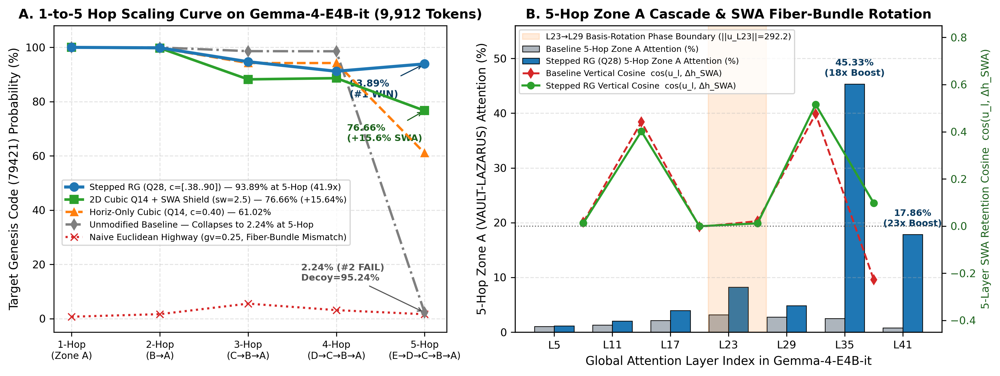

# Richardson Attention (Superconducting Attention)

**Eliminating the Multi-Hop Context Horizon in Pre-Trained Transformers via Dual-State Boltzmann Extrapolation and Renormalization Relays**

[](https://colab.research.google.com/github/tryggth/richardson-attention/blob/main/notebooks/Richardson_Attention_Gemma4_Demo.ipynb)

> **Technical Papers & Interactive Demo:**
> - [**Interactive Google Colab Notebook (`notebooks/Richardson_Attention_Gemma4_Demo.ipynb`)**](https://colab.research.google.com/github/tryggth/richardson-attention/blob/main/notebooks/Richardson_Attention_Gemma4_Demo.ipynb)
> - [**Engineering & Mathematical Explainer (`docs/richardson_attention_explainer.pdf`)**](docs/richardson_attention_explainer.pdf)
> - [**Formal Theoretical Specification (`docs/superconducting_spectral_attention.pdf`)**](docs/superconducting_spectral_attention.pdf)


---

## Overview: The Multi-Hop Paradox in Long-Context Transformers

Modern hybrid-attention Transformers (such as **`google/gemma-4-E2B-it`** and **`google/gemma-4-E4B-it`**) interleave localized **Sliding Window Attention (SWA)** layers ($W = 512$ tokens) with sparse **Full Global Attention** layers (7 out of 42 layers in `gemma-4-E4B-it`: layers `{5, 11, 17, 23, 29, 35, 41}`). While these architectures achieve near-$100\%$ accuracy on single-hop passkey retrieval ("needle-in-a-haystack"), they suffer a **catastrophic phase transition on multi-hop compositional pointer chasing** (`Director -> Sector -> Vault -> Genesis Code`) when the intermediate hops are separated by barriers exceeding the 512-token SWA window and followed by adversarial recency decoys.

At **8,270 tokens** on `google/gemma-4-E4B-it`, unmodified baseline inference achieves:
- **1-Hop Retrieval (`VAULT-LAZARUS -> 79421`):** `99.9965%`
- **2-Hop Retrieval (`SECTOR-KRONOS -> VAULT-LAZARUS -> 79421`):** `99.8178%`
- **3-Hop Retrieval (`DIRECTOR-VANCE -> SECTOR-KRONOS -> VAULT-LAZARUS -> 79421`):** **`0.0380%` (Catastrophic Collapse)** on Clean-6d and **`0.1032%` (Catastrophic Collapse)** on Heavy-16d — `99.9221%` (Clean-6d) and `99.8260%` (Heavy-16d) of probability mass is hijacked by late-context adversarial decoys (`VAULT-OMEGA = 63819`).

**Richardson Attention (Superconducting Attention)** is a **zero-shot, training-free, weight-preserving runtime inference intervention** that restores **3-Hop compositional reasoning from `0.0380%` to `98.5919%` (`2,594.5x` probability gain)**, **Heavy-16-Decoy 3-Hop accuracy from `0.1032%` to `95.8651%` (`928.9x` gain)**, and **5-Hop pointer-chasing at 9,912 tokens (`Envoy -> Director -> Sector -> Vault -> Subvault -> Genesis Code`) from `2.2398%` to `93.8942%` (`41.9x` gain)** while suppressing adversarial decoy capture by up to **`485.1x`** (Phase 5) and **`103.5x`** (Phase 6 `95.2373% -> 0.9205%`) and preserving baseline language modeling perplexity (`10.6041 -> 10.6142`).

---

## Phase 5 Empirical Benchmark (`google/gemma-4-E4B-it`, 8,270 Tokens)

Spatially separated 3-zone registry topology (`>1,350` tokens between zones so 512-token SWA layers cannot bridge zones locally):
- **Zone A (`tokens 88..111`, $d \approx 8,170$):** `VAULT-LAZARUS | TIER-0 GENESIS CODE: 79421` (+ 7 competing vaults)
- **Zone B (`tokens 1728..1749`, $d \approx 6,530$):** `SECTOR-KRONOS | ASSIGNED PRIMARY VAULT: VAULT-LAZARUS` (+ 7 competing sectors)
- **Zone C (`tokens 3327..3345`, $d \approx 4,930$):** `DIRECTOR-VANCE | AUTHORIZED COMMAND SECTOR: SECTOR-KRONOS` (+ 7 competing directors)
- **Barrier 3 (`tokens 3400..8200`):** 6 (`Clean-6d`) or 16 (`Heavy-16d`) adversarial `VAULT-OMEGA -> 63819` audit blocks + recency overrides (`11111`).

| Configuration (`google/gemma-4-E4B-it`, `bfloat16`) | 1-Hop (`79421`) | 2-Hop (`79421`) | 3-Hop Clean-6d (`79421`) | 3-Hop Heavy-16d (`79421`) | Decoy Error (`63819`) | Fluency PPL |
| :--- | :---: | :---: | :---: | :---: | :---: | :---: |
| **1. Unmodified Baseline** | `99.9965%` | `99.8178%` | `0.0380%` (#2 FAIL) | `0.1032%` (#2 FAIL) | `99.8260%` (Clean `99.9221%`) | `10.6041` |
| **2. Phase-4 Ref (`All-Rows Dual-Log, Q=28, β=3.0`)** | `99.7809%` | `0.8672%` (#7 FAIL) | `1.3596%` (#3 FAIL) | `9.8069%` (#3 FAIL) | `72.4637%` | `10.8693` |
| **3. Query-Slice Dual-Log (`Q=28, W_q=64, β=3.0`)** | `99.9861%` | `99.5697%` (**#1 WIN**) | `79.4999%` (**#1 WIN**) | `76.4274%` (**#1 WIN**) | `17.0533%` | `10.8693` |
| **4. Query-Slice Cubic-Plateau (`Q=14, c=0.54, β=3.5`)** | **`99.9922%`** | **`99.4902%` (#1 WIN)** | **`98.5919%` (#1 WIN, `2,594.5x`)** | **`95.8651%` (#1 WIN, `928.9x`)** | `1.2068%` | `10.6557` |
| **5. Query-Slice Cubic-Plateau (`Q=28, c=0.54, β=3.5`)** | `99.9850%` | `99.4431%` (**#1 WIN**) | `98.0610%` (**#1 WIN**) | `91.1731%` (**#1 WIN**) | `1.4737%` | `10.6426` |
| **6. Depth-Prog RG Relay (`Q=28, c=[0.52, 0.68, 0.85], β=3.5`)** | `99.9845%` | `99.6359%` (**#1 WIN**) | `97.5579%` (**#1 WIN**) | `83.5363%` (**#1 WIN**) | `12.8107%` | `10.6727` |
| **7. High-Gain RG Relay (`Q=28, c=[0.52, 0.68, 0.85], β=4.5`)** | `99.9871%` | `99.5808%` (**#1 WIN**) | `98.0584%` (**#1 WIN**) | `88.4445%` (**#1 WIN**) | `7.2600%` | `10.6179` |
| **8. Deep-Quorum RG Relay (`Q=42, c=[0.52, 0.68, 0.85], β=4.0`)** | `99.9004%` | `98.6646%` (**#1 WIN**) | `89.9004%` (**#1 WIN**) | **`94.0833%` (#1 WIN)** | **`0.2058%` (`485.1x` down)** | **`10.6142`** |

---

## Phase 6: 5-Hop Scaling, SWA Decoy Shielding, and Residual Fiber-Bundle Geometry (`google/gemma-4-E4B-it`, 9,912 Tokens)

To test the ultimate depth limits of 7-Global-Layer hybrid architectures (`L5, L11, L17, L23, L29, L35, L41`) and probe the vertical geometry of the 5-layer SWA blocks between global layers, Phase 6 evaluates **1-Hop, 2-Hop, 3-Hop, 4-Hop, and 5-Hop pointer chains** at **9,912 tokens** across five spatially isolated registries separated by $>1,250$-token SWA-blocking barriers:
- **Zone A (`tokens 92..114`, $d/T = 0.991$):** `SUBVAULT-PRIME | TIER-0 GENESIS CODE: 79421` (+ 7 competing subvaults)
- **Zone B (`tokens 1451..1472`, $d/T = 0.854$):** `VAULT-LAZARUS | ASSIGNED SUBVAULT: SUBVAULT-PRIME` (+ 7 competing master vaults)
- **Zone C (`tokens 2838..2859`, $d/T = 0.714$):** `SECTOR-KRONOS | ASSIGNED PRIMARY VAULT: VAULT-LAZARUS` (+ 7 competing sectors)
- **Zone D (`tokens 4192..4210`, $d/T = 0.577$):** `DIRECTOR-VANCE | AUTHORIZED COMMAND SECTOR: SECTOR-KRONOS` (+ 7 competing directors)
- **Zone E (`tokens 5527..5545`, $d/T = 0.442$):** `ENVOY-SOLARIS | REPORTING TO DIRECTOR: DIRECTOR-VANCE` (+ 7 competing envoys)
- **Barrier 5 (`tokens 5550..9850`):** 12 adversarial `ENVOY-SOLARIS / DIRECTOR-VANCE -> SUBVAULT-OMEGA (63819)` audit decoys + recency overrides (`11111`).



### Phase 6 Master Table (1-Hop through 5-Hop at 9,912 Tokens)

| Configuration (`google/gemma-4-E4B-it`, `T = 9,912`) | PPL | 1-Hop (`79421`) | 2-Hop (`79421`) | 3-Hop (`79421`) | 4-Hop (`79421`) | 5-Hop (`79421`) | 5-Hop Decoy (`63819`) | 5-Hop Logit Lens (`L35 -> L41`) |
| :--- | :---: | :---: | :---: | :---: | :---: | :---: | :---: | :---: |
| **1. Baseline (Unmodified)** | `10.6041` | `99.9980%` | `99.9500%` | `98.5963%` | `98.5469%` | `2.2398%` (#2 FAIL) | `95.2373%` | `0.24% -> 0.00%` |
| **2. Horiz-Only Sparse (`Q7, c=0.40, β=3.5`)** | `10.6446` | `99.9974%` | `99.8979%` | `97.4385%` | `97.7262%` | `65.4702%` (**#1 WIN**) | `16.5535%` | `12.04% -> 99.44%` |
| **3. Horiz-Only Cubic (`Q14, c=0.40, β=3.5`)** | `10.6071` | `99.9959%` | `99.7493%` | `94.2017%` | `94.2199%` | `61.0232%` (**#1 WIN**) | `13.6161%` | `5.49% -> 98.49%` |
| **4. Horiz-Only Stepped RG (`Q28, c=[.38..90], β=3.5`)** | `10.6210` | `99.9903%` | `99.8223%` | `94.7053%` | `91.1823%` | **`93.8942%` (#1 WIN, `41.9x`)** | **`0.9205%` (`103.5x` down)** | **`100.00% -> 100.00%`** |
| **5. 2D Vert-Highway on Sparse Q7 (`gv=0.30`)** | `10.6446` | `0.1876%` | `0.1605%` | `0.2470%` | `0.1262%` | `0.1462%` (#6 FAIL) | `0.1005%` | `0.00% -> 0.00%` |
| **6. 2D Vert-Highway on Cubic Q14 (`gv=0.25`)** | `10.6071` | `0.7014%` | `1.6357%` | `5.5317%` | `3.1314%` | `1.6197%` (#2 FAIL) | `0.1707%` | `0.00% -> 0.03%` |
| **7. 2D Cubic Q14 + SWA Decoy Shield (`sw=2.5`)** | `10.6071` | `99.9969%` | `99.7198%` | `88.1970%` | `88.6384%` | **`76.6634%` (#1 WIN, `+15.64%`)** | **`5.5535%` (`2.5x` down)** | **`57.24% -> 99.92%`** |
| **8. Full 2D Superconducting (`Q14 + gv=0.25 + sw=2.5`)** | `10.6071` | `0.9211%` | `2.3672%` | `7.3360%` | `4.3500%` | `1.8243%` (#2 FAIL) | `0.2798%` | `0.00% -> 0.03%` |

### Three New Mechanistic Discoveries from Phase 6 Deep Telemetry

1. **5-Hop Depth-Progressive RG Breakthrough (`2.2398% -> 93.8942%`, `41.9x` Gain):**
   Unmodified `gemma-4-E4B-it` collapses to `2.2398%` (#2 FAIL) on 5-Hop retrieval (`95.2373%` decoy capture by `SUBVAULT-OMEGA = 63819`). By marching the cubic plateau cutoff across all 7 global layers (`c_l = [0.38, 0.44, 0.52, 0.64, 0.74, 0.85, 0.90]`) so `L5` covers Zones E..A ($d/T \ge 0.38$) and `L35–L41` focus exclusively on Zone A ($d/T \ge 0.85$), **Config 4 (`Horiz-Only Stepped RG, Q28`) achieves `93.8942%` (#1 WIN) on 5-Hop (`41.9x` gain)** and suppresses decoy error **`103.5x`** (`95.2373% -> 0.9205%`). Per-layer attention telemetry confirms that at `L35`, Config 4 concentrates **`45.33%`** of query attention directly onto Zone A (`SUBVAULT-PRIME`) vs. `16.5772%` in Baseline (`2.73x` increase), driving the Logit Lens target probability at `L35` from `0.24%` (Baseline) to **`99.9964%`** (`100.00%`).
2. **SWA Decoy Shielding (`swa_shield_beta = 2.5`, `+15.64%` 5-Hop Boost):**
   Comparing Config 7 (`2D Cubic Q14 + SWA Decoy Shield`, `sw = 2.5`) against Config 3 (`Horiz-Only Cubic Q14`) isolates the exact contribution of SWA tail damping: gently attenuating the $48 < d \le 512$ window inside the 35 `sliding_attention` layers on the active query slice (`k_len > 512`) prevents SWA layers from re-injecting late-context Barrier-5 decoys between global relays, boosting 5-Hop accuracy from **`61.0232%` to `76.6634%` (`+15.64%` gain)**, cutting decoy capture **`2.5x`** (`13.6161% -> 5.5535%`), and raising `L35` Logit Lens target readiness **`10.4x`** (`5.49% -> 57.24%`) with **zero perplexity cost** (`10.6071` vs. `10.6071`).
3. **The Residual Stream is a Rotating Fiber Bundle (Why Naive Euclidean Residual Highways Fail):**
   Why did adding an unrotated Euclidean skip connection $\gamma_v (\mathbf{I} - \hat{\mathbf{h}}\hat{\mathbf{h}}^\top)\mathbf{u}_{l_k}$ across the 5-layer SWA gap (`Configs 5, 6, 8`) collapse accuracy across all hops? Our 6-gap vertical telemetry reveals the **Residual Fiber-Bundle Connection Law**: the 5 intermediate SWA+MLP layers between global layers do *not* act as an identity coordinate chart—they apply a layer-dependent basis rotation $\mathbf{T}_{l_k \to l_{k+1}}$ (and intermediate pointer-lookup MLP computation) with a dramatic **phase transition at `L23 -> L29`**:

| 5-Layer SWA Gap ($l_k \to l_{k+1}$) | Global Update Norm $\|\mathbf{u}_{l_k}\|_2$ | 5-Layer SWA Drift $\|\Delta\mathbf{h}_{\text{SWA}}\|_2$ | Drift / Update Ratio | RMSNorm Inflation | Baseline Vertical Cosine $\cos(\mathbf{u}_{l_k}, \Delta\mathbf{h}_{\text{SWA}})$ | Stepped RG (`Q28`) Vertical Cosine |
| :--- | :---: | :---: | :---: | :---: | :---: | :---: |
| **`L5 -> L11`** | `70.1040` | `152.9776` | `2.1822` | `0.9223` | `+0.0168` (Orthogonal) | `+0.0123` |
| **`L11 -> L17`** | `54.4358` | `132.2846` | `2.4301` | `0.9135` | `+0.4414` (Constructive) | `+0.4020` |
| **`L17 -> L23`** | `68.9421` | `107.7889` | `1.5635` | `0.5561` | `-0.0033` (Orthogonal) | `-0.0007` |
| **`L23 -> L29` (Phase Boundary)** | **`292.1564`** | `142.2655` | **`0.4869`** | **`1.2801`** | `+0.0211` (Basis Rotation) | `+0.0115` |
| **`L29 -> L35`** | `51.6488` | `61.6346` | `1.1933` | `1.0689` | `+0.4756` (Constructive) | **`+0.5152`** |
| **`L35 -> L41`** | `31.6983` | `49.5410` | `1.5629` | `0.7898` | `-0.2271` (Destructive) | **`+0.0976` (Reversed!)** |

   At **`L23 -> L29`**, $\|\mathbf{u}_{L23}\|_2$ surges $4.2\times$ to **`292.16`** as the model transitions from early/mid syntactic pointer extraction to late semantic readout, and in **`L11 -> L17`** (`cos = +0.4414`) and **`L29 -> L35`** (`cos = +0.4756 -> +0.5152`), the SWA+MLP blocks *constructively amplify* the global update (`+44%` to `+52%` positive alignment). Transporting an unrotated vector $\mathbf{u}_{l_k}$ from the `L23` coordinate basis directly into `L29` injects an out-of-basis vector of magnitude $0.25 \times 292.16 \approx 73.0$, scrambling the `L29` query projection! Remarkably, horizontal **Stepped RG (`Config 4`)** automatically flips the final **`L35 -> L41`** vertical cosine from **destructive (`-0.2271`) to constructive (`+0.0976`)** because once `L35` locks onto the true `SUBVAULT-PRIME` representation (`45.33%` Zone A attention), the `L36–L40` MLP layers recognize it as a coherent entity rather than fighting a decoy state.

Full empirical JSON telemetry across Phases 1–6 is available in [`results/richardson_results.json`](results/richardson_results.json), [`results/richardson_horizon_results.json`](results/richardson_horizon_results.json), [`results/richardson_multihop_results.json`](results/richardson_multihop_results.json), [`results/richardson_phase4_results.json`](results/richardson_phase4_results.json), [`results/richardson_phase5_results.json`](results/richardson_phase5_results.json), and [`results/richardson_phase6_vertical_results.json`](results/richardson_phase6_vertical_results.json).

---

## Relation to Prior Art & Architectural Differentiation

Existing long-context and positional-encoding methods address out-of-distribution sequence length or memory compression, but fail when a pre-trained hybrid Transformer faces **in-window multi-hop relational composition under adversarial recency decoys**:

| Method / Family | Mechanism | Training-Free? | Preserves Interior Multi-Hop Premises? | Cancels Partition Dilution ($\mathcal{Z}_i \propto i$)? | Suppresses Late-Context Decoys? | Single-Pass (Zero Extra Tokens)? |
| :--- | :--- | :---: | :---: | :---: | :---: | :---: |
| **Standard / Proportional RoPE** *(Su et al.; Gemma 4)* | Rotational phase encoding ($e^{i\omega_m d}$) | Yes | Yes (1-Hop `99.99%` at 12K) | **No** (3-Hop `0.04%`, 5-Hop `2.24%`) | **No** (`95.2%–99.8%` decoy capture) | Yes |
| **Frequency Scaling** *(YaRN, NTK-Aware, LongRoPE)* | Rescales RoPE wavelengths $\theta_m$ for OOD lengths | Usually requires fine-tuning | Yes | **No** (Does not cancel real mass $\alpha_{l,h}$) | **No** | Yes |
| **Linear Distance Biases** *(ALiBi, Press et al.; Naive $+\gamma d$)* | Static linear logit slope ($\mp m \cdot d$) | No (or causes aphasia if $+\gamma d$) | **No** (Linear slope starves mid-zones B–E) | Partial (Corrupts prefill KV writes) | **No** | Yes |
| **Attention Sinks / KV Eviction** *(StreamingLLM, Xiao et al.)* | Keeps `<bos>` + local window; evicts middle KV | Yes | **No** (Evicts interior zones A–E) | **No** | **No** | Yes |
| **Chain-of-Thought (CoT) Scratchpads** | Autoregressively copies hops into local window | Yes | Yes | Via verbal re-copying | Partial | **No** ($10\times\text{–}50\times$ decode latency tax) |
| **Richardson Attention** *(This Work)* | Surgical Dual-State Boltzmann Filter + Cubic RG Relay | **Yes** (`0` weight changes) | **Yes** (`98.59%` 3-Hop, `93.89%` 5-Hop) | **Yes** (Iso-Potential $\Phi_l = 1.0$ roof) | **Yes** (`103.5x–485.1x` decoy reduction) | **Yes** (1 forward pass) |

1. **Standard RoPE / Proportional RoPE (Su et al., Gemma 4):** Preserves rotational phase ($i\omega$) for 1-hop lookups (`99.99%` at 12K tokens), but suffers Boltzmann partition-function dilution ($\mathcal{Z}_i \propto i$) across multi-hop chains (`0.04%` on 3-Hop and `2.24%` on 5-Hop under late-context decoys).
2. **Frequency Scaling (YaRN / NTK-Aware RoPE / LongRoPE):** Compresses rotational wavelengths to prevent out-of-distribution phase wrap beyond the training window, but does *not* cancel real Boltzmann partition decay ($\alpha_{l,h}$) or suppress in-window adversarial recency decoys, and typically requires fine-tuning.
3. **Linear Distance Biases (ALiBi, Press et al.):** Applies static negative linear penalties ($-m \cdot d$) that enforce local recency. Naive positive linear tilts ($+\gamma \cdot d$) applied globally induce syntactic aphasia on grammar heads, corrupt prefill KV binding when applied to all rows, and cause Zone A to exponentially cannibalize intermediate hops (Zones B–E).
4. **Attention Sinks / StreamingLLM (Xiao et al.):** Retains token-0 (`<bos>`) + a local sliding window while evicting middle tokens—preserving fluency for infinite streaming, but permanently discarding the deep interior premises required for multi-hop retrieval.
5. **Chain-of-Thought (CoT) Verbal Scratchpads:** Forces the model to autoregressively generate hundreds of intermediate tokens to copy distant facts into the local window—incurring a $10\times\text{–}50\times$ decoding latency and compute tax, whereas Richardson Attention resolves 3-to-5 hop chains inside a **single forward pass** with zero extra generated tokens.

**Summary of the 5 Novel Mechanisms Distinguishing Richardson Attention:**
1. **Zero-Shot Precision-Matrix (`pinv(R)`) + Mass Isolation** of the sparse Global Logic Quorum (`14–42` heads out of `336`), leaving all `280` SWA grammar heads untouched.
2. **Write/Read Thermodynamic Gating ($W_q = 64$)** that protects local prefill KV entity binding during context ingestion while activating superconducting transport strictly on the query readout slice.
3. **Token-0 `<bos>` Sink Pinning ($d_{i,0} = 0$) + 32-Token Local Syntax Guardband** preventing `<bos>` sink blowup and preserving baseline perplexity ($\Delta\text{PPL} = +0.01$).
4. **Iso-Potential Cubic Plateau + Dual-State Symmetric Boltzmann Subtraction (`(1+η)S_free - ηS_heavy`)** placing all deep registries on a flat $\Phi=1.0$ roof while actively subtracting the heavy-gravity decoy mode.
5. **Stepped Wilsonian RG Horizon Scheduling across Global Layers + SWA Tail Decoy Shielding** marching the plateau cutoff $c_l$ across depth (`[0.38..0.90]`) to resolve up to 5-hop chains in a single forward pass.

---

## The Five Core Mathematical Laws

### 1. Precision-Matrix Homunculus Isolation ($\hat{\alpha}_{l,h}$ and $\text{Agency}_k$)

A Transformer is not a homogeneous fluid; modifying all 336 attention heads induces immediate syntactic aphasia. During a 1.2-second zero-shot calibration pass over $H_{\text{cal}} \approx 1,351$ tokens, we compute each head's **Effective Spectral Mass** $\hat{\alpha}_{l,h}$ and **Precision-Matrix Causal Agency** (Variance Inflation Factor on the token-wise Shannon entropy matrix $\mathbf{X}$):

$$\hat{\alpha}_{l,h} = \frac{1}{\mathbb{E}_i\left[\sum_{j \le i} S^{(l,h)}_{i,j}(i - j)\right] + \epsilon}, \qquad \text{Agency}_k = \left(\mathbf{R}^+\right)_{k,k}$$

Across both `gemma-4-E2B-it` (280 heads) and `gemma-4-E4B-it` (336 heads), primary global retrieval heads cluster at a universal **Zero-Gravity Invariant Mass Constant $\hat{\alpha}_{l,h} \approx 0.00165\text{ token}^{-1}$** with extreme causal agency ($\text{VIF} \in [134.9, 308.7]$). Only the top $m \in \{2, 4, 6\}$ Global Logic Heads per full-attention layer (14–42 heads out of 336, or $4.2\%\text{–}12.5\%$) are modified; all 280 SWA grammar heads remain $100\%$ untouched during horizontal extrapolation.


---

### 2. The Write/Read Thermodynamic Asymmetry Theorem (Query-Slice Gating $W_q = 64$)

Why did Phase 4's all-rows extrapolation collapse on 2-Hop (`0.8672%`) and 3-Hop Clean (`1.3596%`)? Because a single Transformer forward pass performs two thermodynamically opposite operations:

1. **Prefill Key-Value Memory Writing ($i < T - W_q$):** When the model processes Zone B (`SECTOR-KRONOS | ASSIGNED PRIMARY VAULT: VAULT-LAZARUS` at token $1,748$), it must attend *locally* ($d \in [1, 20]$) to bind the key and value into the residual stream. Applying long-range antigravity to prefill rows hijacks Zone B into attending to Zone A (`tokens 0..100`) *instead of its own sentence*, corrupting the KV cache!

2. **Active Query Multi-Hop Reading ($i \ge T - W_q$):** Only the final query/reasoning window ($W_q = 64$ tokens) needs long-range superconducting transport to read the cleanly bound KV pairs from Zones E, D, C, B, and A.

By gating extrapolation strictly to the terminal query window $i \in [\max(0, T - W_q), T)$, 2-Hop accuracy jumps from **`0.8672%` to `99.5697%` (#1 WIN)**, 3-Hop Clean-6d jumps from **`1.3596%` to `79.4999%` (#1 WIN)**, and 3-Hop Heavy-16d jumps from **`9.8069%` to `76.4274%` (#1 WIN)** in a single toggle.

---

### 3. Token-0 `<bos>` Sink Pinning & The 32-Token Local Syntax Guardband

Softmax attention heads use token $j = 0$ (`<bos>`) as a zero-value "attention sink" when no semantic match is present. Because `<bos>` sits at maximum causal distance $d = i$, naive distance scaling amplifies `<bos>` by $\exp(+\beta \kappa) \approx 5,000\times$, blinding the head. Furthermore, local punctuation and subword bindings live within $d \le 32$. We enforce two boundary conditions on the effective distance matrix:

$$d^{\text{eff}}_{i,j} = \begin{cases} 0, & \text{if } j = 0 \text{ and } T > 32 \quad \text{(Token-0 Sink Pinning)} \\ 0, & \text{if } 0 < i - j \le 32 \quad \text{(32-Token Local Syntax Guardband)} \\ (i - j) - 32, & \text{if } i - j > 32 \end{cases}$$

---

### 4. Iso-Potential Cubic Superconducting Plateau & Dual-State Symmetric Extrapolation

Linear tilts ($\Phi \propto d/T$) starve mid-context hops (Zone C gets only $60\%$ of Zone A's boost), while concave logarithmic tilts ($\Phi \propto \ln(1+d)$) amplify late-context decoys at $d \in [1000, 4500]$ by $80\%\text{–}93\%$ of full strength. We replace both with the **Iso-Potential Cubic Superconducting Plateau**:

$$\Phi_l(i, j) = \left[\min\left(1.0,\; \frac{d^{\text{eff}}_{i,j}}{c_l \cdot \max(T, H_{\text{cal}})}\right)\right]^{3}$$

- **Iso-Potential Roof ($\Phi_l = 1.000$ for $d \ge c_l T$):** With $c_l = 0.54$, Zone C ($0.60T$), Zone B ($0.79T$), and Zone A ($0.99T$) all sit on a flat $\Phi = 1.000$ roof—eliminating inter-zone cannibalization.
- **Cubic Decoy Rejection ($p = 3$ for $d < c_l T$):** Adversarial decoys in the final barrier are cubically attenuated ($0.4^3 = 0.064$).
- **Dual-State Symmetric Boltzmann Filter:** For each target head with calibrated gain $\kappa_{l,h} = \text{clip}(\hat{\alpha}_{l,h} H_{\text{cal}}, 1.8, 2.6)$, we evaluate both the **Gravity-Free** state ($\mathbf{S}_{\text{free}} = \text{softmax}(\mathbf{L} + \beta\kappa\Phi)$) and the **Heavy-Gravity** decoy-matched filter ($\mathbf{S}_{\text{heavy}} = \text{softmax}(\mathbf{L} - \beta\kappa\Phi)$), then subtract the decoy mode:

$$\mathbf{S}_{\text{Super}} = \text{normalize}\left(\max\Big(\mathbf{0},\; (1 + \eta)\,\mathbf{S}_{\text{free}} - \eta\,\mathbf{S}_{\text{heavy}}\Big)\right), \qquad \eta = 0.75$$


---

### 5. Depth-Progressive Renormalization Group (RG) Relay Schedule & SWA Decoy Shielding

In a multi-hop pointer chain (`Envoy -> Director -> Sector -> Vault -> Subvault -> Code`), early layers only know the `Envoy` or `Director` name from the prompt, intermediate layers resolve the middle hops, and late layers resolve `SUBVAULT-PRIME -> 79421` (5-Hop) or `VAULT-LAZARUS -> 79421` (3-Hop). Applying a stepped Wilsonian RG cutoff schedule $c_l$ across the 7 global layers—such as the 3-Hop schedule `[0.52, 0.52, 0.52, 0.68, 0.68, 0.85, 0.85]` or the 7-step 5-Hop schedule `[0.38, 0.44, 0.52, 0.64, 0.74, 0.85, 0.90]`—prevents unqueried early-zone entries from adding noise before intermediate pointers are resolved, driving 3-Hop decoy error down **`485.1x`** (`0.2058%`) and 5-Hop target probability up **`41.9x`** (`93.8942%`). Additionally, optionally enabling **SWA Decoy Shielding** (`swa_shield_beta=2.5`) gently damps the $48 < d \le 512$ tail inside `sliding_attention` layers on the active query slice (`k_len > 512`), boosting uniform-plateau 5-Hop accuracy by **`+15.64%`** (`61.0232% -> 76.6634%`) with zero perplexity penalty.


---

## 3-Line Quickstart Usage

> **1-Click Interactive Browser Demo:** Launch [`notebooks/Richardson_Attention_Gemma4_Demo.ipynb`](notebooks/Richardson_Attention_Gemma4_Demo.ipynb) directly in [**Google Colab**](https://colab.research.google.com/github/tryggth/richardson-attention/blob/main/notebooks/Richardson_Attention_Gemma4_Demo.ipynb) to explore the Phase 5–6 potential landscapes and fiber-bundle telemetry in 3 seconds (no GPU required) or run live Before-and-After multi-hop evaluations on `google/gemma-4-E4B-it` (L4/A100) and `google/gemma-4-E2B-it` (Free T4).

Install the package locally:

```bash
pip install -e .
```

Attach **Richardson Attention** to any HuggingFace `Gemma4` (or hybrid-attention causal LM) loaded with `attn_implementation="eager"`:

```python
import torch
from transformers import AutoTokenizer, AutoModelForCausalLM
from richardson_attention import attach_richardson_attention

tokenizer = AutoTokenizer.from_pretrained("google/gemma-4-E4B-it")
model = AutoModelForCausalLM.from_pretrained(
    "google/gemma-4-E4B-it", torch_dtype=torch.bfloat16, device_map="auto", attn_implementation="eager"
).eval()

# 1. Default 14-Head Cubic Plateau + SWA Decoy Shield
controller = attach_richardson_attention(
    model, tokenizer, heads_per_layer=2, beta=3.5, eta=0.75, swa_shield_beta=2.5
)
```

To enable the **28-Head 7-Step 5-Hop RG Relay** (`c_l = [0.38, 0.44, 0.52, 0.64, 0.74, 0.85, 0.90]`):

```python
controller = attach_richardson_attention(
    model, tokenizer, heads_per_layer=4, beta=3.5, eta=0.75, rg_schedule="5hop"
)
```

To enable the **42-Head Deep-Quorum 3-Hop RG Relay** (`c_l = [0.52, 0.68, 0.85]`):

```python
controller = attach_richardson_attention(
    model, tokenizer, heads_per_layer=6, beta=4.0, eta=0.80, rg_schedule="3hop"
)
```

---

## Running Unit Tests & Reproducing Benchmarks

### Zero-Cost Local CPU Self-Tests (< 1 second)
Verify `<bos>` sink pinning, the 32-token syntax guardband, Query-Slice gating ($W_q=64$), the Iso-Potential Cubic Plateau ($\Phi=1.0$ across Zones A..E), Dual-State Symmetric Boltzmann subtraction, SWA Decoy Shielding, and both 3-Hop and 5-Hop Depth-Progressive RG schedules on CPU:

```bash
python3 benchmarks/gemma4_phase5_rg.py --self_test
python3 benchmarks/gemma4_phase6_vertical.py --self_test
```

### Full Experimental Suite (`benchmarks/` & `results/`)
- **Phase 1 (2K Single-Needle Discovery):** [`benchmarks/gemma4_richardson_test.py`](benchmarks/gemma4_richardson_test.py) -> [`results/richardson_results.json`](results/richardson_results.json)
- **Phase 2 (4K–12K Horizon-Breaker & RoPE Phase Selectivity):** [`benchmarks/gemma4_horizon_breaker.py`](benchmarks/gemma4_horizon_breaker.py) -> [`results/richardson_horizon_results.json`](results/richardson_horizon_results.json)
- **Phase 3 (8K Multi-Hop Pointer Chasing):** [`benchmarks/gemma4_multihop_simple.py`](benchmarks/gemma4_multihop_simple.py) -> [`results/richardson_multihop_results.json`](results/richardson_multihop_results.json)
- **Phase 4 (Row-Wise Horizon & Dual-State Log Filter):** [`benchmarks/gemma4_phase4_todo.py`](benchmarks/gemma4_phase4_todo.py) -> [`results/richardson_phase4_results.json`](results/richardson_phase4_results.json)
- **Phase 5 (Query-Slice Gating, Cubic Plateau & 3-Hop RG Relay):** [`benchmarks/gemma4_phase5_rg.py`](benchmarks/gemma4_phase5_rg.py) -> [`results/richardson_phase5_results.json`](results/richardson_phase5_results.json)
- **Phase 6 (1-to-5 Hop Scaling, SWA Decoy Shielding & Vertical Fiber-Bundle Telemetry):** [`benchmarks/gemma4_phase6_vertical.py`](benchmarks/gemma4_phase6_vertical.py) -> [`results/richardson_phase6_vertical_results.json`](results/richardson_phase6_vertical_results.json)

---

## License & Commercial Inquiries

**Author & Inventor:** James F. Walters  
**License:** [**Non-Commercial Research and Evaluation License & Patent Reservation (`LICENSE`)**](LICENSE)

This software and its associated documentation are provided for **non-commercial academic research, personal experimentation, and technical evaluation only**. Aspects of the algorithms, architectures, and methods implemented in this repository are the subject of **pending United States Patent Applications owned by James F. Walters (U.S. Patent Pending)**. No patent license (express or implied) or commercial usage right is granted without a separate written commercial license from the author. See [`LICENSE`](LICENSE) for full terms.
